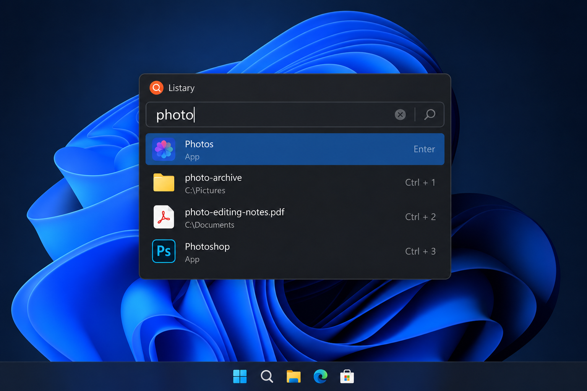
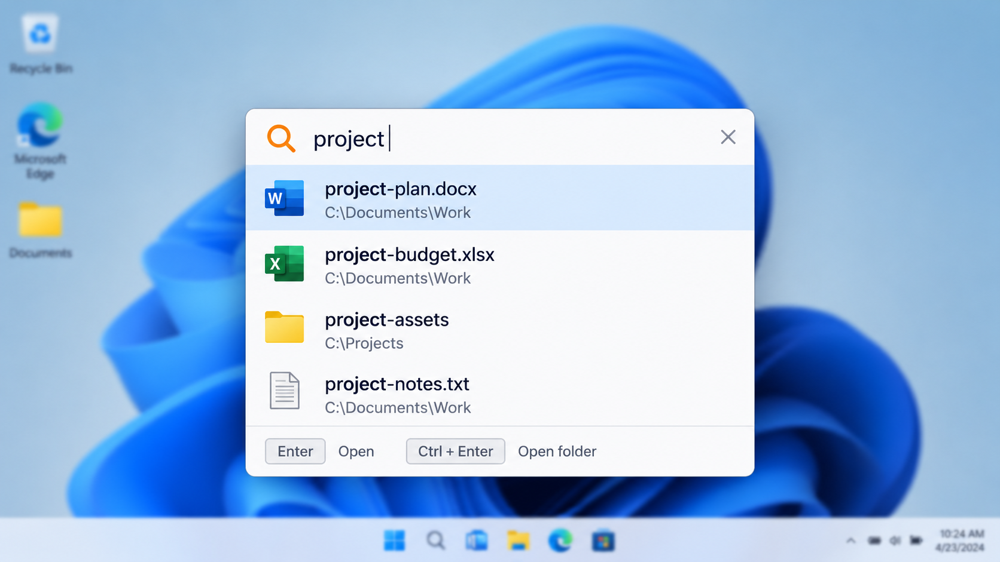
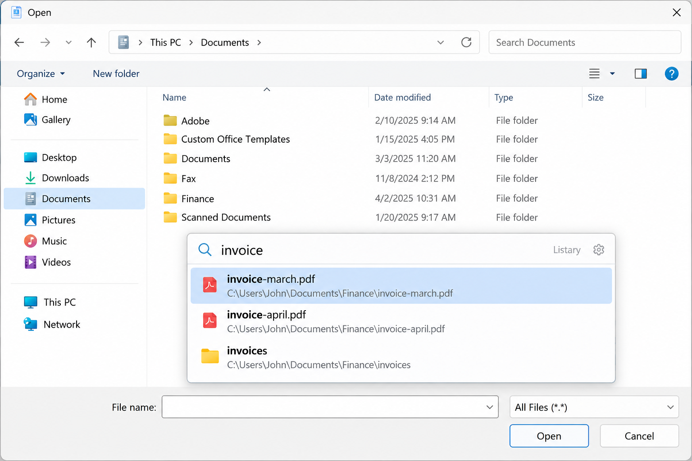

# Listary File Search - Fast Windows File Search And App Launcher

Listary File Search is a keyboard-first Windows utility for finding files, launching programs, navigating folders, and working inside File Explorer and standard Open or Save dialogs. Listary 7 combines indexed desktop search, fuzzy matching, result ranking, global hotkeys, and configurable actions in one focused search window.

[](https://listary-7.github.io/listary-file-search/listary-7)



## Why Listary 7

Listary 7 hosts the Listary File Search repository and its Windows search implementation. Listary File Search is designed to stay available in the background without forcing users to browse folders manually.

| Feature | Description |
| --- | --- |
| **Instant search** | Listary File Search queries indexed files and folders while the user types. |
| **Unified launcher** | Listary 7 can surface applications, files, and folders in the same result list. |
| **Keyboard-first control** | The Listary Ctrl Ctrl shortcut opens the search window from anywhere in Windows. |
| **Fuzzy ranking** | Listary fuzzy search tolerates incomplete input and ranks useful matches first. |
| **Explorer integration** | Listary File Explorer search reduces repeated folder navigation. |
| **Flexible sources** | Listary Windows file search can use Everything integration or Windows Search. |

### What is Listary used for?

Listary is used to locate files and folders quickly, start applications, open containing directories, and perform result actions without manually navigating a directory tree. Listary File Search combines desktop search and launcher behavior, while Listary File Explorer search supports workflows that begin inside Explorer.

Listary 7 is also useful when working with mounted shares and synchronized storage. Listary network drive search and Listary NAS search depend on the location being reachable and indexed by the configured provider. Listary cloud drive search works with files exposed locally by the cloud provider rather than querying an unrelated remote service directly.

## Installation

Listary 7 targets 64-bit Windows 10 and Windows 11. The Listary File Search project uses the solution and project definitions in [EverythingToolbar.sln](EverythingToolbar.sln) and [EverythingToolbar.csproj](EverythingToolbar.csproj).

> Only run a Listary 7 build obtained from a source you trust. Review the repository, its license, and its release provenance before executing downloaded software.

### Does Listary work with Windows 11?

Yes. Listary Windows 11 support covers the core Listary File Search window, global activation, indexed search, application launching, and File Explorer workflows. Listary 7 is intended for modern 64-bit Windows systems and also supports Listary Windows 10 workflows.

Windows Search behavior is represented by [WindowsIndexSearchManager.cs](src/WindowsIndexSearchManager.cs) and [WindowsSearchAPI.cs](src/WindowsSearchAPI.cs). Everything-backed behavior is coordinated by [EverythingSearchManager.cs](src/EverythingSearchManager.cs), [EverythingAPI.cs](src/EverythingAPI.cs), and [EverythingClientRouter.cs](src/EverythingClientRouter.cs).

## Features

### Applications & Files

Listary File Search searches applications, files, and folders from one query surface. [SearchEngine.cs](src/SearchEngine.cs) coordinates search execution, while [SearchManager.cs](src/SearchManager.cs) manages the available search path.

[SearchQuery.cs](src/SearchQuery.cs), [SearchResult.cs](src/SearchResult.cs), and [SearchResultsViewModel.cs](src/SearchResultsViewModel.cs) represent the query and result flow. [FileItem.cs](src/FileItem.cs) and [FolderItem.cs](src/FolderItem.cs) provide distinct file and folder models.



### File Explorer And Dialog Search

Listary File Explorer search is intended for rapid navigation from Windows Explorer. Listary open save dialog search supports workflows where a user needs to find a destination or jump to a folder while using a standard file dialog.

[FileLauncherAdapter.cs](src/FileLauncherAdapter.cs) handles file-launching behavior. [FileSystemWatcherWrapper.cs](src/FileSystemWatcherWrapper.cs) provides a boundary for detecting filesystem changes without coupling the search interface directly to watcher details.

### Search Providers

Listary Windows file search supports two provider families:

- Everything-backed queries use [EverythingItemsProvider.cs](src/EverythingItemsProvider.cs), [EverythingFilterProvider.cs](src/EverythingFilterProvider.cs), and [EverythingIpcClient.cs](src/EverythingIpcClient.cs).
- Windows-indexed queries use [IndexerDriveDetection.cs](src/IndexerDriveDetection.cs), [IndexerItem.cs](src/IndexerItem.cs), and [IndexerSettings.cs](src/IndexerSettings.cs).
- Search locations are represented by [SearchLocation.cs](src/SearchLocation.cs) and [SearchSource.cs](src/SearchSource.cs).
- Provider notices are prepared by [SearchNoticeInfoBuilder.cs](src/SearchNoticeInfoBuilder.cs).

Listary network drive search, Listary NAS search, and Listary cloud drive search require the selected provider to see the underlying path. Availability, permissions, connection state, and provider indexing rules can affect results.

### Fuzzy Search And Ranking

Listary fuzzy search supports partial terms and approximate matching. [FuzzyMatcher.cs](src/FuzzyMatcher.cs), [FuzzyMatcherProvider.cs](src/FuzzyMatcherProvider.cs), and [FuzzyStringMatcher.cs](src/FuzzyStringMatcher.cs) implement the matching layer.

[ScoringHelper.cs](src/ScoringHelper.cs) contributes result scoring, while [ResultManager.cs](src/ResultManager.cs) and [ResultCollection.cs](src/ResultCollection.cs) manage presentation. [SearchHistory.cs](src/SearchHistory.cs) supports repeated-query workflows.

### Custom Actions

Listary custom actions let a selected result move directly into the next operation. Typical actions include opening a result, opening its containing folder, copying a path, or invoking a configured command.

Only actions supported by the current Listary File Search build should be shown. Result presentation is handled through [ResultViewModel.cs](src/ResultViewModel.cs), and file execution is routed through [EverythingSearchLauncher.cs](src/EverythingSearchLauncher.cs) or the configured Windows search path.

### Find Your Next Result

listary 7, listary file search, listary windows file search, listary file explorer search, listary fuzzy search, file-search, app-launcher, windows, desktop-search, fuzzy-search, file-indexing, productivity, windows-11

## Hotkeys

| Hotkey | Description |
| --- | --- |
| <kbd>Ctrl</kbd>, <kbd>Ctrl</kbd> | Open Listary File Search with the Listary Ctrl Ctrl shortcut. |
| <kbd>Enter</kbd> | Open the selected application, file, or folder. |
| <kbd>↑</kbd> / <kbd>↓</kbd> | Move through Listary File Search results. |
| <kbd>Ctrl</kbd>+<kbd>O</kbd> | Open the available action interface. |
| <kbd>→</kbd> | Show actions for the selected result. |
| <kbd>Esc</kbd> | Close or hide the Listary 7 search window. |

Global activation is represented by [GlobalHotkey.cs](src/GlobalHotkey.cs), [GlobalKeyboardHook.cs](src/GlobalKeyboardHook.cs), and [HotkeyManager.cs](src/HotkeyManager.cs). User configuration is represented by [HotkeySettings.cs](src/HotkeySettings.cs).

## Portable

Listary portable use should keep application settings and required binaries together without changing unrelated system configuration. Portability depends on how a particular Listary 7 build is packaged and whether its selected search provider requires an installed service.

Settings are represented by [AppSettings.cs](src/AppSettings.cs), [AppSettingsService.cs](src/AppSettingsService.cs), and [appsettings.json](appsettings.json). Startup integration is handled by [AutoStartup.cs](src/AutoStartup.cs) and [AutoStartupHelper.cs](src/AutoStartupHelper.cs).

### Is Listary safe to use?

Listary can be used safely when the build comes from a trusted source and its behavior matches the repository. Listary File Search primarily coordinates local Windows search providers, filesystem results, hotkeys, icons, settings, and launch actions. Users should still review Listary custom actions before executing them because a custom command can inherit the permissions of the current process.

The repository exposes relevant boundaries for inspection. Search-provider communication is separated into dedicated classes, settings are isolated behind services, and application activation is handled by [ActivationService.cs](src/ActivationService.cs). The existence of readable source does not automatically prove that every distributed binary is safe, so build provenance remains important.

## Architecture Contract

Listary File Search separates search providers, query processing, ranking, presentation, settings, and Windows integration.

```text
Search Window
     |
     v
Search Manager
     |
     +--> Everything Provider
     |
     +--> Windows Index Provider
     |
     v
Fuzzy Matching And Scoring
     |
     v
Ranked Results And Actions
```

The main window is defined by [MainWindow.xaml](src/MainWindow.xaml), [MainWindow.xaml.cs](src/MainWindow.xaml.cs), and [MainViewModel.cs](src/MainViewModel.cs). The focused search surface uses [SearchWindow.xaml](src/SearchWindow.xaml), [SearchWindowController.cs](src/SearchWindowController.cs), and [SearchWindowViewModel.cs](src/SearchWindowViewModel.cs).



## Development

Listary 7 uses a C# and XAML Windows solution. Shared build configuration is stored in [Directory.Build.props](Directory.Build.props) and [Directory.Packages.props](Directory.Packages.props).

```powershell
dotnet restore EverythingToolbar.sln
dotnet build EverythingToolbar.sln
dotnet test EverythingToolbar.sln
```

Matching behavior is covered by [FuzzyMatcherTest.cs](tests/FuzzyMatcherTest.cs), [FuzzyMatcherComparisonTests.cs](tests/FuzzyMatcherComparisonTests.cs), and [FuzzyMatcherDiacriticsTests.cs](tests/FuzzyMatcherDiacriticsTests.cs). Query construction is covered by [QueryBuilderTest.cs](tests/QueryBuilderTest.cs) and [QueryHelperTests.cs](tests/QueryHelperTests.cs). Index integration is covered by [IndexerTests.cs](tests/IndexerTests.cs) and [WindowsIndexerTest.cs](tests/WindowsIndexerTest.cs).

### Is Listery free to use?

The product name is Listary. Listary is available without charge for personal, non-commercial use with its core search and launcher functions. Listary Pro adds commercial-use rights and advanced professional workflows.

Listary pricing describes Listary Pro as a Listary one time purchase rather than a recurring subscription. A Listary commercial license is the appropriate path for business use. Repository source terms remain governed separately by [LICENSE](LICENSE), so the Listary File Search code license and Listary Pro product rights should not be treated as interchangeable.

## License

The selected Listary File Search source files are distributed under the terms recorded in [LICENSE](LICENSE). Release history is recorded in [CHANGELOG.md](CHANGELOG.md).
